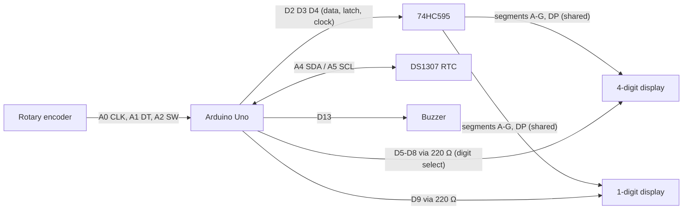

# Arduino Desk Clock

A desk clock with a countdown timer and stopwatch, built on an Arduino Uno from starter-kit parts. A 4-digit 7-segment display shows the time, a 1-digit display shows AM/PM (or extra timer detail), and everything is controlled with a single rotary knob.

## Features

- **Clock**: 12-hour time kept by a DS1307 real-time clock (keeps time through power loss with its coin cell), blinking separator, AM/PM digit.
- **Countdown timer**: set with the knob from 5 seconds up to 99 hours 55 minutes. Step size scales with the time (5 s steps under a minute, up to 5 min steps over an hour), and every value lands on a round number. A fast spin takes bigger jumps.
- **Stopwatch**: up to 99:59:59.
- **Live detail on the small digit**: tenths of a second under an hour; over an hour, a 6-segment "ring" where each segment is 10 seconds (it empties for the timer and fills for the stopwatch).
- **Alarm**: buzzer and flashing display when the timer ends, from any screen.
- **Background indicator**: a dot on the clock's AM/PM digit blinks while the timer or stopwatch runs in the background.
- **One-knob interface**: turn to pick a screen, press to go in.

## Controls

Turn the knob to cycle **Clock → Timer → Stopwatch**. The small digit shows where you are: `A`/`P` = clock, `t` = timer, `S` = stopwatch. Press on the Timer or Stopwatch screen to go into it.

| | Timer (inside) | Stopwatch (inside) |
|---|---|---|
| **Turn** | set the time; once running, steps back out | steps back out |
| **Press** | start / pause | start / stop |
| **Hold 1 s** | started: reset · still setting: step out and keep the time | reset · at 00.00: step out |

- Stepping out never stops anything; the timer and stopwatch keep running.
- Just peeking at the Timer/Stopwatch screen (not pressed in) returns to the clock after 5 seconds.
- Any press or turn silences the alarm.

**Reading the display**

| What you see | Meaning |
|---|---|
| Steady middle dot | minutes . seconds |
| Blinking middle dot | hours . minutes (same as the clock) |
| Big digits flashing | paused / stopped |
| `t` or `S` blinking | inside, not started yet |

## Hardware

| Part | Notes |
|---|---|
| Arduino Uno R3 | |
| 4-digit 7-segment display (common cathode, CPS05643AB) | time |
| 1-digit 7-segment display (common cathode) | AM/PM, tenths, ring |
| 74HC595 shift register | drives the 8 shared segment lines |
| DS1307 RTC module | timekeeping (I2C) |
| Rotary encoder module (KY-040 style) | the knob |
| Active buzzer | alarm |
| 5 × 220 Ω resistors | one per digit |
| Breadboard + jumper wires | |



### Wiring

**74HC595**: pin 16 (VCC) and pin 10 (MR) → 5V · pin 8 (GND) and pin 13 (OE) → GND · pin 14 (DS) → D2 · pin 12 (ST_CP) → D3 · pin 11 (SH_CP) → D4

**Segments** (each 74HC595 output goes to the same segment on both displays):

| 74HC595 | Segment | 4-digit pin | 1-digit pin |
|---|---|---|---|
| Q0 (15) | A | 11 | 7 |
| Q1 (1) | B | 7 | 6 |
| Q2 (2) | C | 4 | 4 |
| Q3 (3) | D | 2 | 2 |
| Q4 (4) | E | 1 | 1 |
| Q5 (5) | F | 10 | 9 |
| Q6 (6) | G | 5 | 10 |
| Q7 (7) | DP | 3 | 5 |

**Digit select** (Arduino pin → 220 Ω → digit common): D5 → 4-digit pin 12 · D6 → pin 9 · D7 → pin 8 · D8 → pin 6 · D9 → 1-digit pin 3 or 8

**DS1307**: VCC → 5V · GND → GND · SDA → A4 · SCL → A5

**Encoder**: CLK → A0 · DT → A1 · SW → A2 · + → 5V · GND → GND

**Buzzer**: + → D13 · − → GND

## How it works

- **Multiplexing**: all five digits share the same 8 segment lines from the 74HC595. The sketch lights one digit at a time for 2 ms (by pulling its common cathode low through a 220 Ω resistor) and cycles through all five fast enough that they look solid.
- **No blocking code**: everything runs off `millis()` (display refresh, knob reading, timer, stopwatch, buzzer pattern), so the display never flickers while the knob is being used.
- **Knob decoding**: a quadrature state table accumulates encoder transitions and only counts a click when the knob settles in a detent, which filters out contact bounce.
- **Design changes from the original plan**: the kit's MAX7219 turned out to be a dot-matrix module, so a 74HC595 drives the segments instead. The kit's ULN2003 board only exposes 4 inputs (5 digits are needed), so the digits are driven straight from Arduino pins; the 220 Ω resistors keep each digit around 15 mA, within what a pin can sink.

## Getting started

1. Wire it up as above.
2. In the Arduino IDE, install **RTClib** (by Adafruit) from the Library Manager.
3. Upload `firmware/set_rtc_time` once to set the RTC to your computer's clock.
4. Upload `firmware/desk_clock_dial`.

If turning the knob right goes the wrong way, flip `ENC_REVERSE` at the top of the sketch.

`firmware/desk_clock` is the simpler clock-only version (no knob or buzzer needed).

## Simulation

`sim/diagram.json` is a [Wokwi](https://wokwi.com) circuit: create a new Arduino Uno project, paste it into `diagram.json`, paste the sketch into `sketch.ino`, and add RTClib.

## Tests

The sketch's logic can be tested on a computer without the Arduino. `test/` compiles the real sketch against a small fake Arduino (pins, `millis()`, RTC) and simulates turning and pressing the knob: screen navigation, step sizes, timer countdown and alarm, stopwatch, pause flashing, the ring and tenths display, and auto-return to the clock.

```sh
cd test
make
```

## License

MIT. See [LICENSE](LICENSE).
